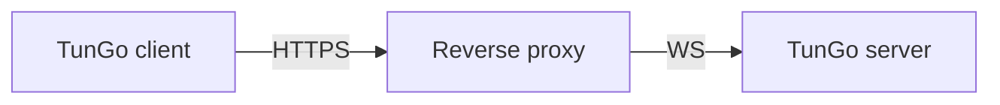

# TunGo over HTTPS

Ordinary HTTPS web traffic establishes a secure connection through a TLS handshake. TunGo can be disguised as web traffic using the following setup:

Any reverse proxy with support for TLS termination and WebSocket can be used. A [setup guide for Caddy](./Deploy%20with%20Caddy.mdx) is available.

When the reverse proxy runs on the same host, [bind all enabled TunGo transports to loopback](../../3.%20Configuration/Server.mdx#example) and disable unused ones. Otherwise, if firewall rules permit access, TunGo ports can be reachable from the internet. A reachable extra port may give a censor an additional clue during [active probing](https://gfw.report/publications/imc20/en/).

To choose which destination subnets use the VPN, set `TunnelRoutesV4` and `TunnelRoutesV6` in the [client configuration](../../3.%20Configuration/Client.mdx#example).

## Prerequisites

A domain pointing to the TunGo server through DNS `A` and/or `AAAA` records.
