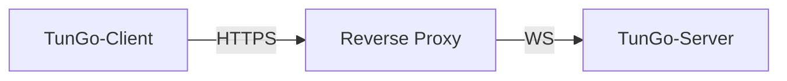

# TunGo über HTTPS

Gewöhnlicher HTTPS-Webverkehr baut über einen TLS-Handshake eine sichere Verbindung auf. TunGo lässt sich mit folgendem Aufbau als solcher Webverkehr tarnen:

Jeder Reverse Proxy mit Unterstützung für TLS-Terminierung und WebSocket ist geeignet. Für Caddy ist eine [Einrichtungsanleitung](./Deploy%20with%20Caddy.mdx) verfügbar.

Wenn der Reverse Proxy auf demselben Host läuft, [binden Sie alle aktivierten TunGo-Transporte an Loopback](../../3.%20Configuration/Server.mdx#example) und deaktivieren Sie ungenutzte Transporte. Andernfalls können TunGo-Ports aus dem Internet erreichbar sein, wenn die Firewall den Zugriff erlaubt. Ein zusätzlich erreichbarer Port kann einem Zensor beim [aktiven Sondieren](https://gfw.report/publications/imc20/en/) einen weiteren Hinweis liefern.

Um festzulegen, welche Zielsubnetze das VPN nutzen, konfiguriere `TunnelRoutesV4` und `TunnelRoutesV6` in der [Client-Konfiguration](../../3.%20Configuration/Client.mdx#example).

## Voraussetzungen

Eine Domain, die über DNS-Einträge vom Typ `A` und/oder `AAAA` auf den TunGo-Server verweist.
