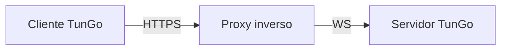

# TunGo sobre HTTPS

El tráfico web habitual por HTTPS establece una conexión segura mediante un handshake TLS. TunGo puede camuflarse como este tráfico con la siguiente configuración:

Puedes utilizar cualquier proxy inverso compatible con terminación TLS y WebSocket. Para Caddy hay una [guía de configuración](./Deploy%20with%20Caddy.mdx).

Si el proxy inverso se ejecuta en el mismo equipo, [vincula todos los transportes habilitados de TunGo a loopback](../../3.%20Configuration/Server.mdx#example) y deshabilita los que no utilices. De lo contrario, los puertos de TunGo pueden ser accesibles desde internet si el cortafuegos permite el acceso. Un puerto adicional accesible puede dar otra pista a un censor durante el [sondeo activo](https://gfw.report/publications/imc20/en/).

Para elegir qué subredes de destino usan la VPN, configura `TunnelRoutesV4` y `TunnelRoutesV6` en la [configuración del cliente](../../3.%20Configuration/Client.mdx#example).

## Requisitos previos

Un dominio que apunte al servidor TunGo mediante registros DNS `A` y/o `AAAA`.
