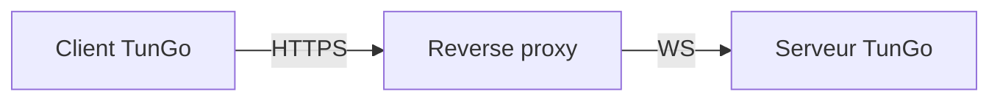

# TunGo via HTTPS

Le trafic web habituel en HTTPS établit une connexion sécurisée par une négociation TLS. TunGo peut se présenter comme ce trafic avec la configuration suivante :

Tout reverse proxy prenant en charge la terminaison TLS et WebSocket convient. Un [guide de configuration pour Caddy](./Deploy%20with%20Caddy.mdx) est disponible.

Si le reverse proxy s’exécute sur le même hôte, [limitez tous les transports TunGo activés au bouclage](../../3.%20Configuration/Server.mdx#example) et désactivez ceux qui sont inutilisés. Sinon, les ports TunGo peuvent être accessibles depuis Internet si le pare-feu autorise l’accès. Un port supplémentaire accessible peut fournir un indice à un censeur lors d’un [sondage actif](https://gfw.report/publications/imc20/en/).

Pour choisir les sous-réseaux de destination qui passent par le VPN, définissez `TunnelRoutesV4` et `TunnelRoutesV6` dans la [configuration du client](../../3.%20Configuration/Client.mdx#example).

## Prérequis

Un domaine pointant vers le serveur TunGo via des enregistrements DNS `A` et/ou `AAAA`.
