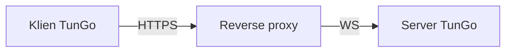

# TunGo melalui HTTPS

Lalu lintas web biasa melalui HTTPS membangun koneksi aman lewat handshake TLS. TunGo dapat disamarkan sebagai lalu lintas ini dengan skema berikut:

Reverse proxy apa pun yang mendukung terminasi TLS dan WebSocket dapat digunakan. Tersedia [panduan konfigurasi untuk Caddy](./Deploy%20with%20Caddy.mdx).

Jika reverse proxy berjalan pada host yang sama, [ikat semua transport TunGo yang aktif ke loopback](../../3.%20Configuration/Server.mdx#example) dan nonaktifkan yang tidak digunakan. Jika tidak, port TunGo dapat diakses dari internet apabila firewall mengizinkannya. Port tambahan yang dapat diakses bisa menjadi petunjuk bagi penyensor saat melakukan [probing aktif](https://gfw.report/publications/imc20/en/).

Untuk memilih subnet tujuan yang menggunakan VPN, atur `TunnelRoutesV4` dan `TunnelRoutesV6` dalam [konfigurasi klien](../../3.%20Configuration/Client.mdx#example).

## Prasyarat

Domain yang mengarah ke server TunGo melalui record DNS `A` dan/atau `AAAA`.
