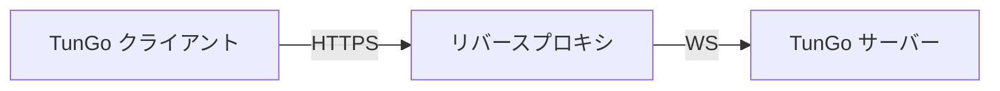

# HTTPS 経由の TunGo

通常の HTTPS Web 通信では、TLS ハンドシェイクによって安全な接続を確立します。TunGo は、次の構成でこのような Web 通信に偽装できます。

TLS 終端と WebSocket に対応したリバースプロキシなら、どれでも使用できます。Caddy には[設定手順](./Deploy%20with%20Caddy.mdx)を用意しています。

リバースプロキシが同じホスト上で動作する場合は、[有効な TunGo トランスポートをすべてループバックにバインド](../../3.%20Configuration/Server.mdx#example)し、使用しないものを無効にしてください。そうしないと、ファイアウォールが許可している場合、TunGo のポートがインターネットから到達可能になります。追加の到達可能なポートは、検閲者による[アクティブプロービング](https://gfw.report/publications/imc20/en/)の手がかりになる可能性があります。

VPN を経由する宛先サブネットを選ぶには、[クライアント設定](../../3.%20Configuration/Client.mdx#example)の `TunnelRoutesV4` と `TunnelRoutesV6` を設定してください。

## 前提条件

DNS の `A` レコード、`AAAA` レコード、または両方で TunGo サーバーを指すドメイン。
