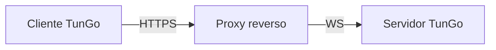

# TunGo sobre HTTPS

O tráfego web comum por HTTPS estabelece uma conexão segura por meio de um handshake TLS. O TunGo pode ser disfarçado como esse tráfego com a seguinte configuração:

Você pode usar qualquer proxy reverso com suporte a terminação TLS e WebSocket. Há um [guia de configuração para o Caddy](./Deploy%20with%20Caddy.mdx).

Se o proxy reverso estiver no mesmo host, [vincule todos os transportes TunGo habilitados ao loopback](../../3.%20Configuration/Server.mdx#example) e desabilite os não utilizados. Caso contrário, as portas do TunGo podem ficar acessíveis pela internet se o firewall permitir. Uma porta adicional acessível pode dar outra pista a um censor durante a [sondagem ativa](https://gfw.report/publications/imc20/en/).

Para escolher quais sub-redes de destino usam a VPN, configure `TunnelRoutesV4` e `TunnelRoutesV6` na [configuração do cliente](../../3.%20Configuration/Client.mdx#example).

## Pré-requisitos

Um domínio apontando para o servidor TunGo por meio de registros DNS `A` e/ou `AAAA`.
