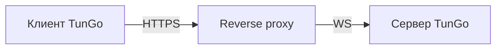

# TunGo через HTTPS

Обычный веб-трафик по HTTPS использует TLS-handshake для установления защищённого соединения. TunGo можно маскировать под такой трафик по следующей схеме:

Подойдёт любой reverse proxy с поддержкой TLS-терминации и WebSocket. Для Caddy доступна [инструкция по настройке](./Deploy%20with%20Caddy.mdx).

Если reverse proxy работает на том же хосте, [привяжите все включённые транспорты TunGo к loopback](../../3.%20Configuration/Server.mdx#example), а неиспользуемые отключите. Иначе, если firewall разрешает доступ, порты TunGo могут быть доступны из интернета. Дополнительный открытый порт может стать сигналом для цензора при [активном зондировании](https://gfw.report/publications/imc20/en/).

Чтобы выбрать, какие подсети назначения направлять через VPN, настройте `TunnelRoutesV4` и `TunnelRoutesV6` в [конфигурации клиента](../../3.%20Configuration/Client.mdx#example).

## Пререквизиты

Домен, указывающий на сервер TunGo через DNS-запись `A` и/или `AAAA`.
