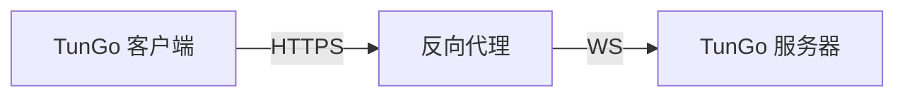

# 通过 HTTPS 运行 TunGo

普通 HTTPS 网页流量通过 TLS 握手建立安全连接。TunGo 可以通过以下架构伪装成这类流量：

可以使用任何支持 TLS 终止和 WebSocket 的反向代理。有关 Caddy 的配置，请参阅[指南](./Deploy%20with%20Caddy.mdx)。

如果反向代理运行在同一主机上，请[将所有已启用的 TunGo 传输协议绑定到回环地址](../../3.%20Configuration/Server.mdx#example)，并禁用不使用的协议。否则，只要防火墙允许访问，TunGo 端口就可能从互联网访问。额外可达的端口可能在审查者进行[主动探测](https://gfw.report/publications/imc20/en/)时提供线索。

要选择通过 VPN 的目标子网，请在[客户端配置](../../3.%20Configuration/Client.mdx#example)中设置 `TunnelRoutesV4` 和 `TunnelRoutesV6`。

## 前提条件

通过 DNS `A` 和/或 `AAAA` 记录指向 TunGo 服务器的域名。
